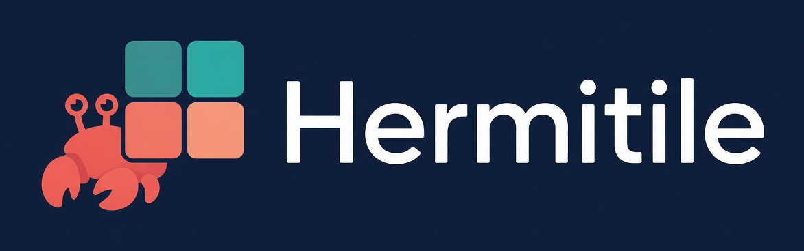
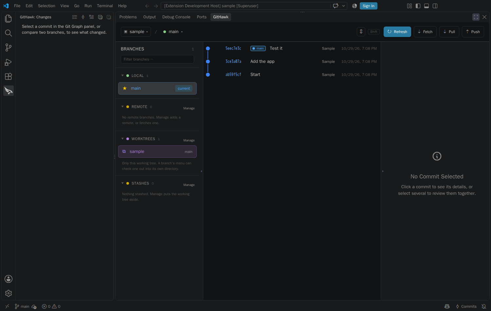
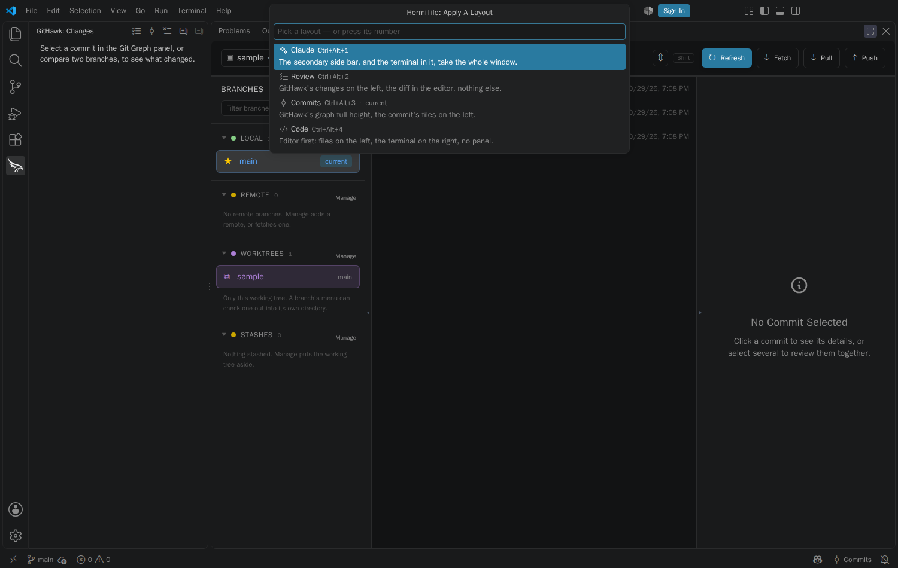
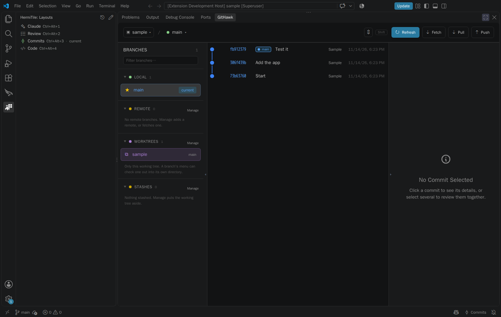
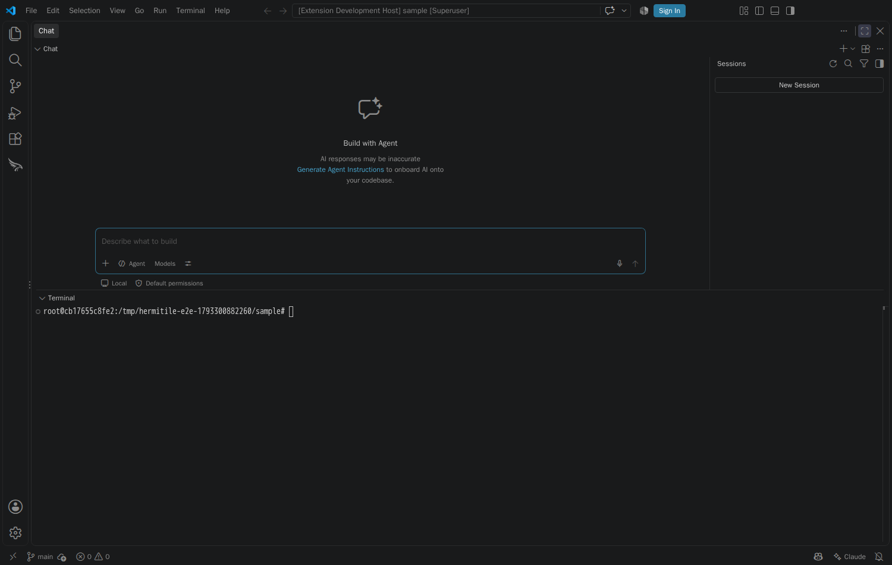
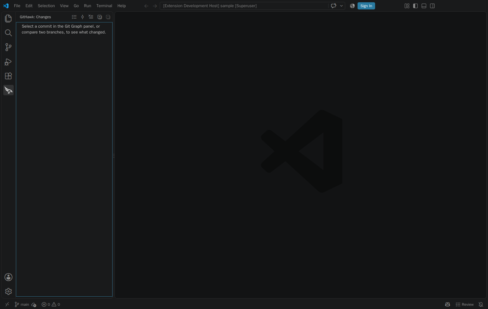
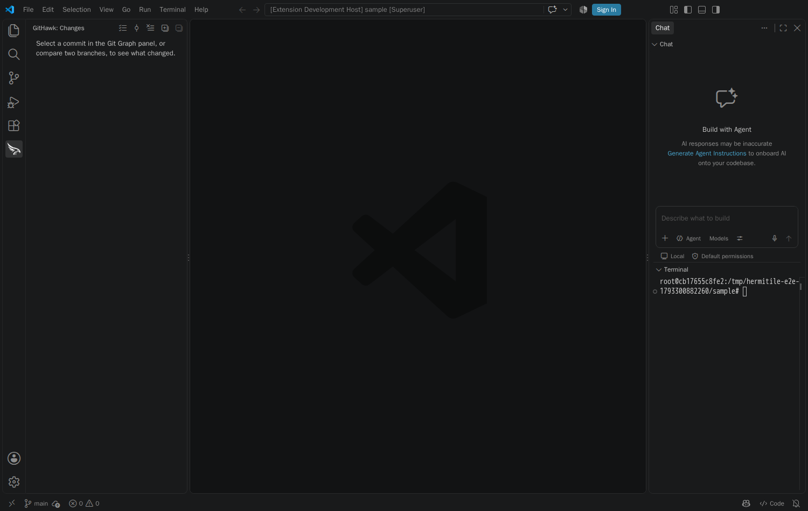

<p align="center">
  
</p>

<p align="center">
  Layouts for VS Code's panels, switched from the keyboard — like windows on a desktop.
</p>

A hermit crab moves into whichever shell suits it. HermiTile moves your workbench into whichever
layout suits what you are doing: talking to an agent in the terminal, reviewing a change,
walking through history. One key, and the side bars, panel and editor snap into place.



[](https://marketplace.visualstudio.com/items?itemName=praktical.hermitile&ssr=false#review-details)
[](https://open-vsx.org/extension/praktical/hermitile/reviews)

## Install

- **VS Code:** search the Extensions view for **HermiTile**, or run
  `code --install-extension praktical.hermitile`.
- **Cursor, VSCodium and other Open VSX editors:** search for **HermiTile** there.

Then press `Ctrl+Alt+1` (macOS: `⌃⌥1`).

## Shortcuts

| Key (macOS: ⌃⌥) | Does |
|---|---|
| `Ctrl+Alt+1` … `9` | Apply the preset at that place in the list |
| `Ctrl+Alt+0` | Pick a preset |
| `Ctrl+Alt+Tab` | Back to the previous layout (again: forward) — Alt+Tab for layouts |
| `Ctrl+Alt+]` / `[` | Next / previous preset |
| `Ctrl+Alt+M` | Maximize the part the keyboard is in; again to restore |

They work with the keyboard in a terminal too: HermiTile adds its commands to
`terminal.integrated.commandsToSkipShell`, so the shell never sees them. (If you have set that
setting yourself, your list replaces the default — add the `hermiTile.*` commands to it.)

Pressing a preset's key again snaps the layout back into shape after you have moved things.
The status bar shows the current preset; click it to pick another.



## The Layouts panel

HermiTile's icon in the activity bar opens every preset with its key, the current one marked.
Click one to apply it. The buttons on top go back to the previous layout and open your presets
in `settings.json`.



## Presets

| # | Preset | Layout |
|---|---|---|
| 1 | **Claude** | The secondary side bar — and the terminal in it — takes the whole window |
| 2 | **Review** | GitHawk's Changes on the left, the diff in the editor, nothing else |
| 3 | **Commits** | GitHawk's graph full height, the commit's files on the left |
| 4 | **Code** | Files on the left, terminal on the right, editor in between, no panel |

Review and Commits are built around [GitHawk](https://githawk.dev), a git graph and code review
extension. Without it they still arrange the side bar and panel, and warn that GitHawk's views
are missing; point them at other views in your own presets.

<details>
<summary>See each preset</summary>

**Claude** — keep your agent's terminal in the secondary side bar, and give it the whole window.



**Review**



**Code**



</details>

## Make your own

Presets live in `settings.json`. The order is the shortcut order:

```jsonc
"hermiTile.presets": [
  {
    "name": "Commits",
    "icon": "$(git-commit)",
    "sideBar": { "state": "visible", "view": "gitHawkChanges" },
    "secondarySideBar": "hidden",
    "panel": { "state": "maximized", "view": "gitHawkView", "position": "bottom", "alignment": "center" },
    "focus": "gitHawkView"
  }
]
```

| Field | Values |
|---|---|
| `sideBar` | `"hidden"`, `"visible"`, or `{ "state", "view" }` |
| `secondarySideBar` | as above, plus `"maximized"` (takes the whole window) |
| `panel` | as above, plus `"maximized"`, `position` (`bottom` `top` `left` `right`), `alignment` (`center` `justify` `left` `right`) |
| `focus` | `editor`, `sideBar`, `secondarySideBar`, `panel`, or any view id |
| `commands` | command ids run last, in order |

A part left out is left alone. A `view` is any view id — `workbench.explorer.fileView`,
`workbench.scm`, `terminal`, `gitHawkView`, `gitHawkChanges`.

Bind a preset by name, rather than by place, in `keybindings.json`:

```jsonc
{ "key": "ctrl+alt+c", "command": "hermiTile.apply", "args": "Claude" }
```

| Setting | Default | |
|---|---|---|
| `hermiTile.presets` | Claude, Review, Commits, Code | The presets, in shortcut order |
| `hermiTile.statusBar` | `true` | Show the current preset in the status bar |

## What VS Code does not let an extension do

- **Read the layout.** HermiTile cannot see what is open, so every preset builds its layout
  from scratch rather than adjusting what is there. It also cannot notice that you rearranged
  things by hand — the status bar shows the last preset applied.
- **Set sizes.** Widths and heights are whatever you last dragged them to.
- **Maximize a top/bottom panel that is not centred.** Give a preset that maximizes the panel
  `"alignment": "center"` (the defaults do).
- **Maximize the primary side bar.** `Ctrl+Alt+M` there hides the panel and secondary side
  bar instead.

## Like it?

A rating helps other people find HermiTile: use the **☆ Rate** buttons at the top.
After a week or so of use, HermiTile asks once (twice at most, if you pick "Later").
"Don't Ask Again" means it. Nothing is sent anywhere; the count stays in your editor.
"Rate HermiTile" is also in the Layouts panel's "…" menu.

## Develop

```bash
npm install
npm run check && npm test   # types, lint, unit tests
npm run e2e                 # a real VS Code in Docker: presses the keys, measures the window
npm run install:local       # package and install into your VS Code
```

## Made by Praktical

HermiTile is built by **Praktical**, the company behind a small family of developer tools.
Our other products:

- **[GitGrit](https://gitgrit.dev)**: define your engineering standards as code, and see how every repository measures up.
- **[GitHawk](https://github.com/kfirzvi-com/githawk)**: a git graph for VS Code that is just a git graph. No AI, no telemetry, no account.

## License

[MIT](LICENSE) © Praktical
